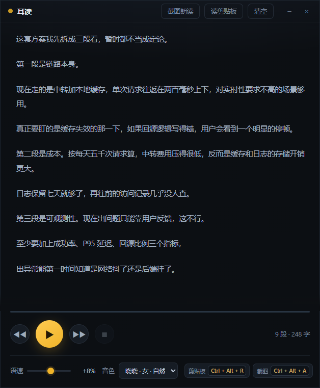

# EarRead

Listen to text instead of staring at it.



A small Windows utility: copy some text, or drag a box over anything on screen, and it reads it back to you in a natural Microsoft neural voice.

Handy when an AI just dumped three walls of text on you, when a PDF is too long to scroll, or when your eyes are tired but you still want to keep going.

The window looks like the screenshot above — the text is split into segments, the one being read is highlighted, and you can click any segment to jump there.

> **Note on how this was made**: the code, documentation and icon in this project were generated by AI. The author defined the requirements, tested everything, and drove the iterations. It is not hand-written by a human, and it says so up front.
>
> The interface itself is in Chinese.

[中文说明](README.md)

## What it does

- **Read clipboard** — copy text, press the hotkey, it starts reading
- **Grab from screen** — drag a box over any region; local OCR turns it into speech (offline, nothing leaves your machine)
- **Follow along** — text is split into segments, the current one lights up and scrolls into view
- **Playback control** — play / pause / previous / next / stop
- **Speed and voice** — -30% to +40% speed, five Chinese voices
- **Custom hotkeys** — click a keycap and press a new combination; supports keyboard combos and **mouse side buttons**

## Quick start (no installation)

1. Download **[EarRead-win64.zip](EarRead-win64.zip)**
2. Extract anywhere
3. Double-click `耳读.exe`

No Python, no environment setup, no terminal.

On first launch it writes `settings.json` next to the executable, holding your hotkeys and voice choice. Delete it to reset.

> Windows 64-bit only. Requires the WebView2 Runtime — bundled with Windows 11, and usually present on Windows 10 if a recent Edge is installed.

## From source

Requires Windows 10 1809+, Python 3.9+, WebView2 Runtime.

```bash
pip install -r requirements.txt
python player_ui.py
```

Optional helpers:

```bash
python make_icon.py       # generate app.ico
python make_shortcut.py   # create a desktop shortcut
```

Build your own executable:

```bash
pip install pyinstaller
pyinstaller --noconfirm --windowed --onedir --name EarRead --icon app.ico ^
  --exclude-module numpy --add-data "ui.html;." player_ui.py
```

## Usage

### Three ways in

| Method | Action |
|---|---|
| Clipboard | Copy text → click the clipboard button, or press the hotkey |
| Screen grab | Click the grab button, or press the hotkey, then drag a box |
| Click a segment | Click any paragraph in the window to start from there |

While grabbing, the screen dims and the cursor becomes a crosshair. Drag a box and release. Right-click or `Esc` cancels.

### Default hotkeys

| Hotkey | Action |
|---|---|
| `Ctrl + Alt + R` | Read clipboard (stops if already reading) |
| `Ctrl + Alt + A` | Grab a screen region and read it |

In-window keys: `Space` play/pause, `Esc` stop, `←` `→` previous/next segment.

### Changing hotkeys

Click either keycap at the bottom right. While it shows a "press a combination" prompt:

- **Keyboard**: hold `Ctrl`, `Alt`, `Shift` or `Win` plus a letter, digit or F-key
- **Mouse**: just press a side button (4 or 5) — no modifier needed

It takes effect immediately and is saved to `settings.json`.

If another program already owns that combination, the status bar says so and your previous binding is restored automatically.

## FAQ

**It went silent halfway through?**

Speech synthesis goes through Microsoft's servers, and they throttle requests. The app falls back to Windows' built-in offline voice automatically — it sounds worse but keeps talking. If two segments fail in a row you'll see a failure notice. Wait a bit and retry.

**My hotkey won't record?**

Keyboard combinations need a modifier (`Ctrl` / `Alt` / `Shift` / `Win`); a bare letter is rejected.

Mouse support is side buttons only — left/middle/right would fire constantly. If your mouse software (Logitech G HUB, Razer Synapse and friends) remaps the side buttons to macros, the raw event never reaches Windows. Remap them back to Back/Forward first.

**The window goes blank for a moment?**

WebView2 pauses rendering while the window sits in the background. A brief blank frame when switching back is normal.

**"Already in use by another program"?**

Something else claimed that combination. Pick another one, or close the culprit. Usual suspects: input method editors, screenshot tools, GPU driver panels.

**Can I run two copies?**

You don't need to — there's a single-instance guard. Launching a second copy closes the first; otherwise they'd fight over hotkeys and stack audio.

## Known limitations

- Screen grab covers the primary monitor only
- OCR works best on clean printed text; vertical text, stylized fonts, handwriting and very small type will produce errors
- The online voice depends on Microsoft's service and occasionally gets rejected (there is an offline fallback)
- Windows only
- The interface is Chinese-only for now

## Implementation notes

The UI is pywebview + WebView2 — dark, frameless, hand-drawn title bar. Audio playback goes through Windows MCI (`winmm.dll`), so there's no pygame or SDL dependency.

Deeper technical notes (synthesis fallback strategy, the two hotkey mechanisms, OCR quirks) are in [REFERENCE.md](REFERENCE.md), written in Chinese.

## License

MIT
