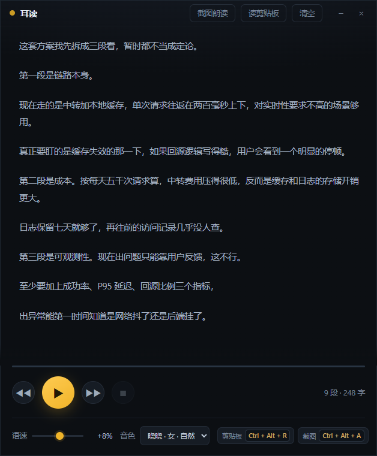

# 耳读 · EarRead

把文字念出来，让眼睛歇一会儿。

[English](README.en.md)



Windows 上的小工具：复制一段文字、或者框选屏幕上的一块区域，用微软的神经网络语音念给你听。

适合这些时候用：AI 回了一大段懒得看、PDF 翻着累、眼睛已经酸了还想再撑一会儿。

打开就是这样——正文分段排好，正在念的那段会亮起来，你可以随时点别的段落跳过去。

> **关于制作方式**：这个项目的代码、文档和图标由 AI 生成，作者负责提需求、测试和反复调整。不假装是人手写的，开头就说清楚。

## 直接用（不用装任何东西）

1. 下载 **[EarRead-win64.zip](EarRead-win64.zip)**
2. 解压到任意目录（放哪都行，路径别带奇怪的符号）
3. 双击里面的 `耳读.exe`

就完了。不用装 Python、不用配环境、不用命令行。

首次启动会在 exe 旁边生成 `settings.json`，存你的热键和音色，删掉就恢复默认。

> 仅支持 Windows 64 位。系统需要 WebView2 运行时——Win11 自带，Win10 装过新版 Edge 的一般也有。

## 从源码跑（想改代码的）

需要 Windows 10 1809 以上、Python 3.9+、WebView2 运行时。

```bash
pip install -r requirements.txt
python player_ui.py
```

想让它像个正经软件，再跑这两个脚本：

```bash
python make_icon.py       # 生成图标 app.ico
python make_shortcut.py   # 在桌面建「耳读」快捷方式
```

自己打包 exe：

```bash
pip install pyinstaller
pyinstaller --noconfirm --windowed --onedir --name EarRead --icon app.ico ^
  --exclude-module numpy --add-data "ui.html;." player_ui.py
```

## 能做什么

- **读剪贴板**：`Ctrl+C` 复制后在耳读里点一下，或者按热键，直接开始念
- **截图取字**：框选屏幕上任意区域，本地 OCR 识别后朗读（离线，图片不出机器）
- **跟读高亮**：正文按句分段，正在念的那段自动高亮并滚到视野中间，点任意一段从那儿开始
- **播放控制**：播放 / 暂停 / 上一段 / 下一段 / 停止
- **语速音色**：语速 -30% ~ +40%，五种中文音色（晓晓 / 云希 / 云健 / 晓伊 / 云扬）
- **自定义热键**：点一下键帽就能重录，支持键盘组合和**鼠标侧键**

## 怎么用

### 三个入口

| 方式 | 操作 |
|---|---|
| 读剪贴板 | 复制文字 → 点标题栏「读剪贴板」，或按热键 |
| 截图取字 | 点「截图朗读」，或按热键，然后拖一个框 |
| 点段落 | 正文里点任意一段，从那里开始念 |

截图取字的时候，屏幕会暗下来、鼠标变十字。拖一个框，松手就开始识别；右键或 `Esc` 取消。

### 默认热键

| 热键 | 作用 |
|---|---|
| `Ctrl + Alt + R` | 读剪贴板（正在念的时候按是停） |
| `Ctrl + Alt + A` | 框选屏幕，识别后朗读 |

窗口内的快捷键：`空格` 播放/暂停，`Esc` 停止，`←` `→` 翻段。

### 改热键

底部右边两个键帽，点一下——它变成"按下组合或侧键…"时：

- **键盘**：按住 `Ctrl` / `Alt` / `Shift` / `Win` 之一再按一个字母、数字或 F 键，例如 `Ctrl + Shift + 9`
- **鼠标**：直接按鼠标侧键（第四、第五键），不需要配修饰键

改完立刻生效，设置存进 `settings.json`。

如果这个组合被别的软件占了，状态栏会告诉你"已被其他程序占用"，并自动退回原来的键。

## 常见问题

**念到一半没声音了？**

合成语音要连微软的服务器，请求太密会被拒。程序会自动退回系统自带的离线语音顶上，音色差一些但保证有声音。如果连续两段都失败，界面会提示"语音合成失败"。等十几秒再试通常就恢复了。

**热键录不进去？**

键盘组合必须带修饰键（`Ctrl` / `Alt` / `Shift` / `Win`），单按一个字母是不收的。

鼠标只支持侧键，不支持左中右——那几个太容易误触。如果你的鼠标装了厂商驱动（罗技 G HUB、雷蛇之类），驱动可能把侧键映射成了复制、宏之类的功能，那样系统层面收不到原始事件，得先去驱动里改回"前进/后退"。

**界面黑了一下 / 切回来时空白？**

窗口在后台的时候 WebView2 会暂停渲染，切回来会有一瞬间空白，属正常现象。

**提示"已被其他程序占用"？**

那个组合被别的软件抢了。换一个，或者把占用的软件关掉。常见的占用者：输入法、截图工具、显卡驱动自带的快捷键面板。

**同时开两个耳读？**

不用管，程序做了单实例保护：开第二个的时候会自动关掉第一个，否则会抢热键、叠音。

## 已知限制

- 截图取字只覆盖主屏，多显示器拼不到一起
- OCR 对清晰的印刷体最准；竖排、艺术字、手写、超小字号会出错
- 在线语音依赖微软服务，网络不好时偶尔会被拒（有离线兜底）
- 只支持 Windows

## 实现要点

界面用 pywebview + WebView2，深色无边框、标题栏自绘。播放走系统自带的 MCI（`winmm.dll`），不依赖 pygame / SDL 这类库。截图选区、OCR、热键的细节见 [REFERENCE.md](REFERENCE.md)。

## License

MIT
